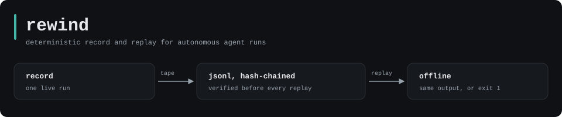
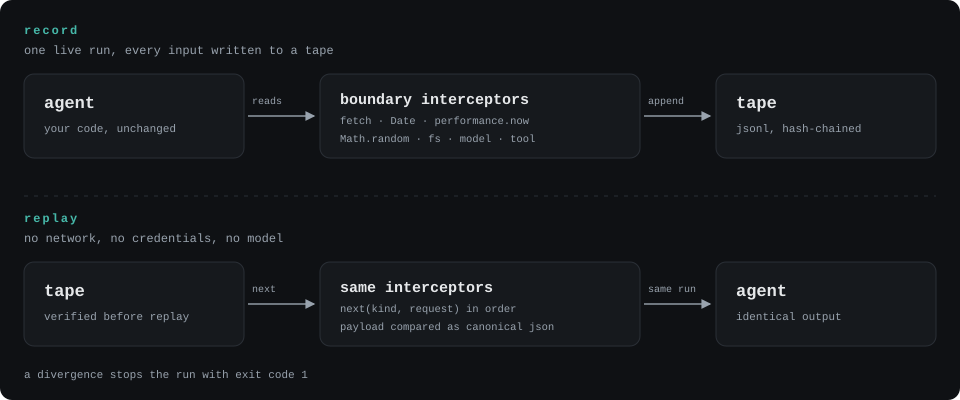
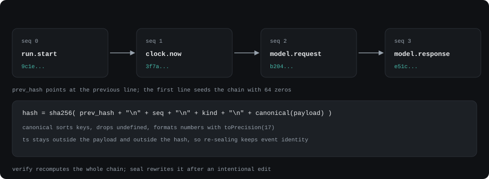
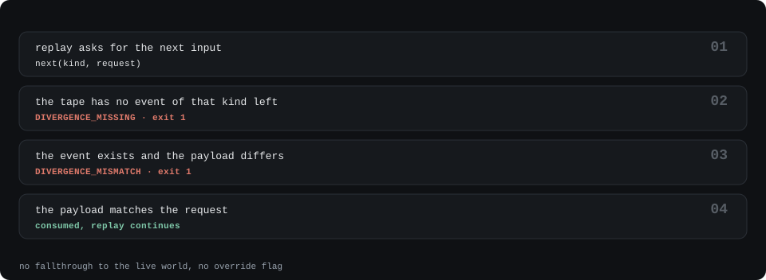

# rewind

Deterministic record and replay for autonomous agent runs

## The problem

Agents are distributed systems with a stochastic participant. You cannot debug
what you cannot reproduce.

A failed run at 03:00 cannot be re-run: the model answers differently, the tool
returns something else, the clock moved, the RNG moved. The usual answer is to
add logging and guess, then guess again tomorrow.

## What it does

`rewind record` captures every non-deterministic input an agent consumes — model
responses, tool calls, filesystem reads, network, clock, RNG — into a tape.
`rewind replay` re-executes the same agent against that tape, offline, with zero
network calls, and fails if the run diverges from the recording.

    rewind record fix-failing-test
    rewind replay tapes/fix-failing-test.tape
    rewind diff tapes/fix-failing-test.tape

The second command produces identical output to the first, on a machine with no
credentials and no connectivity.

## Quick start

    npm ci
    npm test

Replaying the bundled tapes needs nothing else. Recording needs an
OpenAI-compatible endpoint:

    export OPENAI_API_KEY=...
    export OPENAI_BASE_URL=https://api.openai.com/v1
    npx tsx src/cli.ts record fix-failing-test

## Tape format

JSONL, one event per line, SHA-256 hash-chained. Full specification in
[`docs/tape-format.md`](docs/tape-format.md).

## Divergence policy

A missing or differing input is a hard failure, exit code 1, naming the
sequence. There is no fallthrough to the live world and no override flag. See
[`docs/divergences.md`](docs/divergences.md).

## What it does not do

- No multi-agent orchestration, no planner, no memory, no RAG.
- No provider abstraction beyond OpenAI-compatible endpoints.
- No sandboxing. `run_shell` runs with the privileges of the calling process.
- No hosted service, no UI, no dashboard.
- No signing. The hash chain detects accidents, not forgery.

## Design decisions

- [1. Intercept at the runtime boundary, not in agent code](docs/adr/0001-intercept-at-boundary-not-in-code.md)
- [2. Hash-chain the tape for tamper detection](docs/adr/0002-hash-chain-for-tamper-detection.md)
- [3. Divergence is an error, not a warning](docs/adr/0003-divergence-is-an-error-not-a-warning.md)
- [4. No semantic normalization of payloads](docs/adr/0004-no-semantic-normalization.md)
- [5. Tapes are text, not binary](docs/adr/0005-tapes-are-text-not-binary.md)

Threat model and known boundary holes: [`docs/threat-model.md`](docs/threat-model.md).

## Status

Alpha. The tape format will change before 0.1.1 if the boundary holes in the
threat model turn out to matter more than expected.
